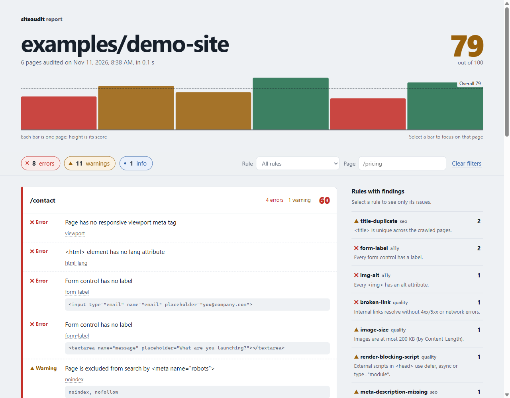
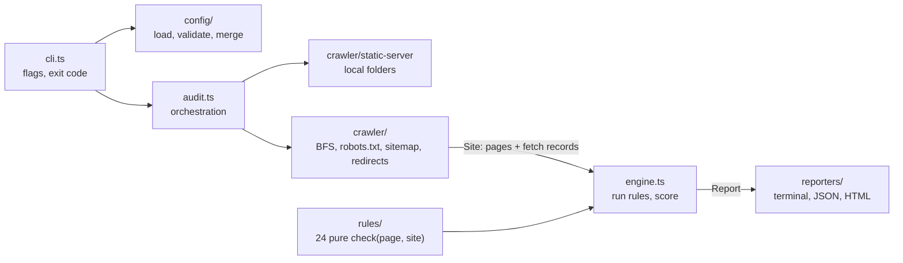

# siteaudit

[](https://github.com/vovaddk/siteaudit/actions/workflows/ci.yml)

**Lint your website like you lint your code.** `siteaudit` crawls a live site or a local build folder, runs 24 SEO, accessibility and quality rules on every page, and tells you what to fix: in the terminal, as JSON, or as a single-file HTML report. Exit codes make it a drop-in CI gate, so a missing `alt`, a stray `noindex` or a broken link fails the build instead of reaching production.

Built for people who ship a lot of landing pages: point it at `./dist` before you deploy, or at the staging URL after.

```text
$ npx siteaudit examples/demo-site

siteaudit 0.1.0  examples/demo-site  6 pages in 0.1s

/  score 64
  ✖ error  Image has no alt attribute                                              img-alt
            
  ✖ error  Broken link to /careers (HTTP 404)                                      broken-link
  ▲ warn   Title "Acme Forms: launch-ready landing pages" is also used by 1 other page(s)  title-duplicate
            /about
  ▲ warn   Image /assets/hero.png is 258 KB (limit 200 KB)                         image-size
  ▲ warn   Render-blocking script in <head>                                        render-blocking-script
            <script src="/assets/analytics.js"></script>

/pricing  score 72
  ✖ error  Link has no accessible name    link-name
            <a href="/contact"><svg width="16" height="16"><circle cx="8" cy="8" r="6"></circle></svg></a>
  ✖ error  Button has no accessible name  button-name
            <button><svg width="16" height="16" aria-hidden="true"><path d="M2 8h12"></path></svg></button>
  ▲ warn   Page has 2 <h1> elements       h1-single
            <h1>Pick a plan</h1>

…

✖ 8 errors   ▲ 11 warnings   ● 1 info   score 79/100
```

The HTML report is one self-contained file (no external assets) with a per-page score chart and filters by severity, rule and page:



## Features

- **Crawler**: breadth-first, same-origin, with a concurrency limit, max pages and max depth. Respects `robots.txt`, discovers pages from `sitemap.xml` (including sitemap indexes), follows and records redirect chains, and checks every internal link and image it finds, even beyond the page limit.
- **Local folders**: `siteaudit ./dist` serves the folder on `127.0.0.1` the way static hosts do (`/about` → `about.html`, `404.html` for misses), so you can audit a build before deploying it.
- **Rules engine**: every rule is a small pure function with an id, a severity and a fix hint. Turn rules off, change their severity, or add your own.
- **Reports**: grouped, colored terminal output; `--json` for tooling; `--html` for humans.
- **CI-friendly**: `--fail-on error|warn|none` decides the exit code.

## Install

Requires Node.js 24 or newer.

```bash
npm install --save-dev siteaudit   # per project
npx siteaudit https://example.com  # or run it without installing
```

## Usage

```bash
siteaudit https://example.com                 # crawl a live site
siteaudit example.com --max-pages 1           # bare domains get https://
siteaudit ./dist --html report.html           # audit a local build, write an HTML report
siteaudit https://staging.example.com --json report.json --fail-on warn
siteaudit ./dist --rule open-graph=off --rule title-length=info --ignore "/blog/**"
siteaudit --list-rules                        # show active rules and their severities
```

| Flag | Default | Description |
| --- | --- | --- |
| `<target>` | | URL, bare domain, or local folder |
| `-p, --max-pages <n>` | `50` | Maximum HTML pages to audit |
| `-d, --max-depth <n>` | `5` | Maximum link depth from the start page (`0` = start page only) |
| `-c, --concurrency <n>` | `8` | Parallel requests |
| `--timeout <ms>` | `15000` | Per-request timeout |
| `--ignore <glob>` | | Skip URLs whose path matches (`*` = one segment, `**` = any depth; `/blog/**` also matches `/blog`). Repeatable |
| `--rule <id=level>` | | Set a rule to `error`, `warn`, `info` or `off`. Repeatable |
| `--ignore-robots` | | Crawl pages disallowed by `robots.txt` |
| `--fail-on <level>` | `error` | Exit with code 1 when issues of this severity (or worse) exist; `none` never fails |
| `--json <file>` | | Write the full report as JSON |
| `--html <file>` | | Write a self-contained HTML report |
| `--config <file>` | `siteaudit.config.{json,ts,mjs,js}` | Config file to load |
| `--no-color` | | Disable colored output |
| `--list-rules` | | Print active rules and exit |

**Exit codes:** `0` passed, `1` issues at or above `--fail-on`, `2` invalid usage, config error, or the start URL could not be fetched.

## Rules

| Rule | Severity | Category | Checks that… |
| --- | --- | --- | --- |
| `title-missing` | error | seo | the page has a non-empty `<title>` |
| `title-length` | warn | seo | the `<title>` is 10–60 characters long |
| `title-duplicate` | warn | seo | no other crawled page uses the same `<title>` |
| `meta-description-missing` | warn | seo | the page has a non-empty `<meta name="description">` |
| `meta-description-duplicate` | warn | seo | no other crawled page uses the same description |
| `h1-single` | warn | seo | the page has exactly one `<h1>` |
| `viewport` | error | seo | the page has a responsive `<meta name="viewport">` |
| `canonical-missing` | warn | seo | the page declares `<link rel="canonical">` |
| `canonical-mismatch` | warn | seo | the canonical URL is the page itself (full URL, trailing slash ignored; path only for local folders, which declare the production domain) |
| `open-graph` | warn | seo | `og:title`, `og:description` and `og:image` are present |
| `noindex` | warn | seo | the page is not excluded by meta robots or `X-Robots-Tag` |
| `sitemap-coverage` | info | seo | the page is listed in `sitemap.xml` (only when a sitemap exists) |
| `html-lang` | error | a11y | `<html>` has a `lang` attribute |
| `heading-order` | warn | a11y | heading levels never skip (no `<h2>` straight to `<h4>`) |
| `img-alt` | error | a11y | every `` has an `alt` attribute (`alt=""` is fine for decoration) |
| `link-name` | error | a11y | every link has an accessible name (text, `aria-label`, image alt…) |
| `button-name` | error | a11y | every button has an accessible name |
| `form-label` | error | a11y | every form control has a label (a placeholder is not one) |
| `broken-link` | error | quality | internal links do not return 4xx/5xx or fail |
| `redirect-chain` | warn | quality | internal links go through at most one redirect |
| `mixed-content` | error | quality | HTTPS pages load no scripts, styles, images or frames over HTTP |
| `image-size` | warn | quality | images are at most 200 KB (by `Content-Length`) |
| `render-blocking-script` | warn | quality | external scripts in `<head>` use `defer`, `async` or `type="module"` |
| `favicon` | warn | quality | the site has `<link rel="icon">` or a working `/favicon.ico` |

**Scoring.** Each page starts at 100 and loses 12 points per failing error rule, 4 per warning rule and 1 per info rule. A rule counts once per page, so forty images without `alt` cost the same as one. The overall score is the average of page scores.

## Configuration

Put `siteaudit.config.json` (or `.ts`, `.mjs`, `.js`) in the directory you run the command from. Command-line flags override the file; `--rule` and `--ignore` add to it.

```json
{
  "maxPages": 100,
  "maxDepth": 4,
  "concurrency": 6,
  "failOn": "warn",
  "ignore": ["/blog/**", "/legal/*"],
  "rules": {
    "open-graph": "off",
    "title-length": "info",
    "sitemap-coverage": "off"
  }
}
```

A TypeScript config gets type checking through `defineConfig`, and can add custom rules (Node 24 runs `.ts` configs natively):

```ts
// siteaudit.config.ts
import { defineConfig } from 'siteaudit';

export default defineConfig({
  failOn: 'warn',
  rules: { favicon: 'off' },
});
```

## CI usage

Audit the production build on every pull request and keep the HTML report as an artifact:

```yaml
# .github/workflows/siteaudit.yml
name: siteaudit
on: [pull_request]

jobs:
  audit:
    runs-on: ubuntu-latest
    steps:
      - uses: actions/checkout@v7
      - uses: actions/setup-node@v7
        with:
          node-version: 24
          cache: npm
      - run: npm ci
      - run: npm run build
      - run: npx siteaudit ./dist --fail-on error --html siteaudit-report.html
      - uses: actions/upload-artifact@v7
        if: always()
        with:
          name: siteaudit-report
          path: siteaudit-report.html
```

To audit a deployed preview instead, pass its URL: `npx siteaudit https://preview-123.example.com --fail-on warn`.

## Architecture



- **`crawler/`** does all network I/O. It parses each HTML page once (cheerio) into a `Page` and collects a `FetchRecord` for every page, link target, image and probe it requested.
- **`rules/`** are pure: `check(page, site)` reads the parsed page and the crawl results and returns findings. No rule does I/O, so each one is unit-tested with inline HTML fixtures.
- **`engine.ts`** applies the configured severities, sorts findings and computes scores.
- **`reporters/`** turn the plain-data `Report` into text, JSON or HTML. The HTML report embeds the report as JSON and renders it with a small inline script; crawled content only reaches the DOM through `textContent`.

## Writing a custom rule

A rule is an object with metadata and a pure `check` function. `page.$` is a [cheerio](https://cheerio.js.org/) instance of the parsed document, and `site` gives access to every crawled page and fetch result.

```ts
// siteaudit.config.ts
import { defineConfig, type Rule } from 'siteaudit';

const noLoremIpsum: Rule = {
  id: 'no-lorem-ipsum',
  severity: 'error',
  category: 'quality',
  description: 'Page contains no placeholder copy.',
  docs: 'Replace "Lorem ipsum" with real content before launch.',
  check(page) {
    return /lorem ipsum/i.test(page.$('body').text())
      ? [{ message: 'Placeholder text "Lorem ipsum" found' }]
      : [];
  },
};

export default defineConfig({ customRules: [noLoremIpsum] });
```

Test it without a crawl by building a page from HTML:

```ts
import { createPage } from 'siteaudit';

const page = createPage({ url: 'https://example.com/', html: '<p>Lorem ipsum</p>' });
const site = { origin: 'https://example.com', local: false, pages: [page], sitemap: undefined, fetched: new Map() };
console.log(noLoremIpsum.check(page, site)); // [{ message: 'Placeholder text "Lorem ipsum" found' }]
```

## Development

```bash
npm install
npm run lint        # ESLint (typescript-eslint strict, type-checked)
npm run typecheck   # tsc, strict
npm test            # vitest: rules, crawler against a local fixture server, config, exit codes, reporters
npm run build       # compile to dist/
npm run demo        # audit examples/demo-site and write reports/demo-report.html
```

`examples/demo-site/` is a small static site with deliberate issues on every page; each one is marked with an HTML comment.

## Roadmap

- **External link checking**: optionally check outbound links too (rate-limited per host); today only same-origin links are verified.
- **JavaScript-rendered pages**: an optional headless-browser mode for SPAs whose content is not in the initial HTML.
- **Baselines**: store the last report and fail CI only on new issues, so the tool can be adopted on an existing site.
- **Configurable thresholds**: rule options such as the image size limit and title length range, which are fixed today.

## License

[MIT](LICENSE) © 2026 Vova Dudnyk
